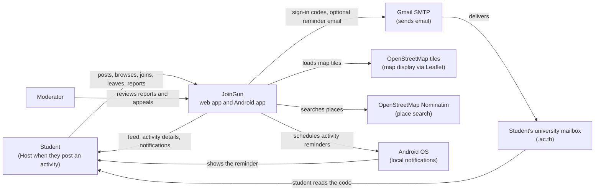
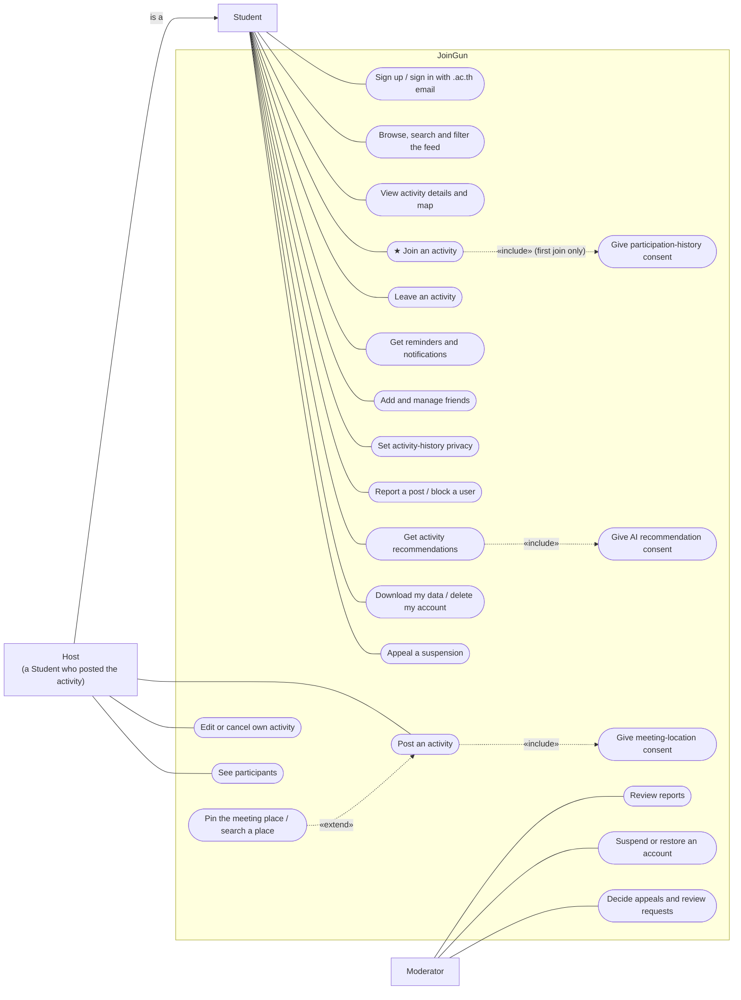
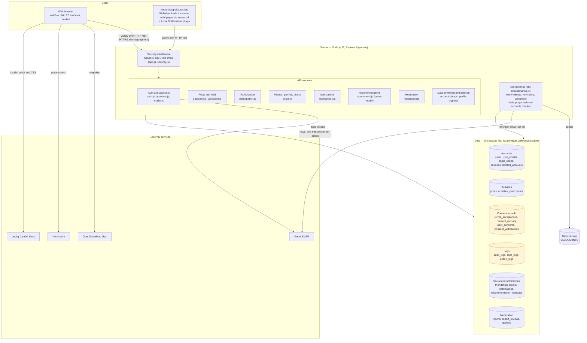
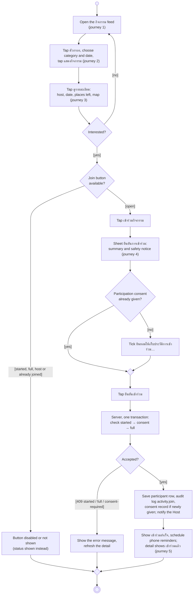
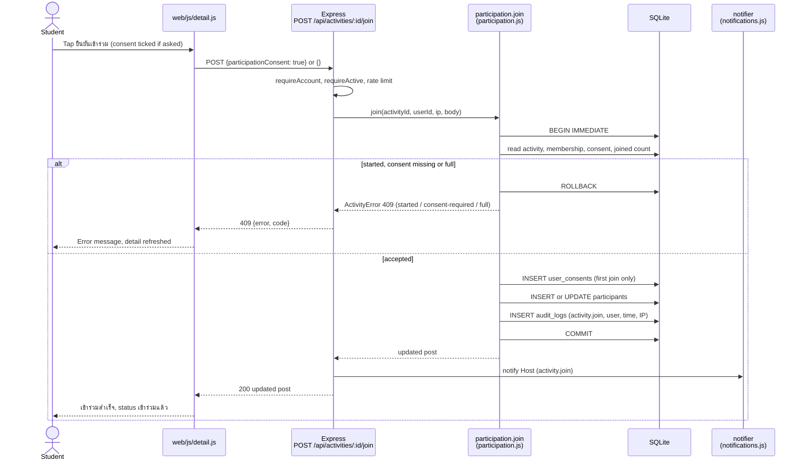

# JoinGun — Diagrams (D1–D4)

| Item | Value |
| --- | --- |
| Status | Draft, 2026-10-28. Drawn from the code of build 0.3.0 (`server/`, `web/`, `capacitor.config.json`). Needs team review. |
| Core workflow | **Join an activity from the feed** ([user journey](user-journey.md), [feature list](feature-list.md)) |
| Inputs | [Requirement spec](../01-requirements/01-spec/20260908-01-joingun.md), [backlog](../01-requirements/backlog.md), [server README](../../server/README.md), [rule.md](../../rule.md) |
| Source format | Mermaid. Each diagram below is the editable source; GitHub and VS Code render it directly. |
| PNG files | The four PNGs in [diagrams/](diagrams/) are the earlier drawings. They disagree with the build in several places (see [Differences from the PNG diagrams](#differences-from-the-png-diagrams)) and should be redrawn from this file. |

Names used in every diagram:

- **Student** — a person signed in with a verified `.ac.th` email address.
- **Host** — the Student who created a given activity. Not a separate account type: the server stores it per activity (`participants.role = 'host'`).
- **Moderator** — an account with `users.role = 'moderator'`, given through `MODERATOR_EMAILS` or `npm run moderator`.

## D1 — System Context

The system as one box, with the people and outside systems it talks to. The database and the recommendation model are inside JoinGun, so they are not drawn here.

## D2 — Use Cases

Mermaid has no use case diagram type, so this uses a flowchart with UML conventions: actors outside the system box, use cases as ovals inside it, a plain line between an actor and a use case, and dashed arrows for «include» and «extend». The core use case is marked ★.

| Use case | Requirement | Backlog | Code (entry point) |
| --- | --- | --- | --- |
| Sign up / sign in with .ac.th email | F1, NFR3 | 1.1, 1.2, 8.1 | `POST /api/auth/request-code`, `/api/auth/verify`, `/api/auth/terms` |
| Browse, search and filter the feed | F3, NFR1 | 2.2, 7.1, 7.2 | `GET /api/posts?category=&date=&q=` |
| View activity details and map | F3, F2 | 2.3, 3.1 | `GET /api/posts/:id`, `web/js/detail.js`, `web/js/map.js` |
| ★ Join an activity | Scope workflow 4, LR1 (no separate F-ID) | 2.4 | `POST /api/activities/:id/join` |
| Give participation-history consent | LR1 | 8.1 | `user_consents` (`participation-history`, `participation-v1`) |
| Leave an activity | No F-ID (backlog and `rule.md` only) | 2.4 | `POST /api/activities/:id/leave` |
| Get reminders and notifications | F4 | 4.1, 4.2 | `GET /api/notifications`, `/api/me/notification-settings`, `web/js/native.js` |
| Add and manage friends | No F-ID (proposal §4) | 5.1, 5.2 | `/api/friends`, `/api/friends/requests` |
| Set activity-history privacy | F5 | 7.3 | `PUT /api/me/privacy` |
| Report a post / block a user | `rule.md` (Computer Crime Act) | 5.3 | `POST /api/reports`, `/api/me/blocks` |
| Get activity recommendations | F6, LR4, LR5 | 6.1, 6.2, 6.3 | `GET /api/recommendations` |
| Give AI recommendation consent | LR1, LR4 | 8.1 | `POST /api/me/consents/ai` |
| Download my data / delete my account | LR2, `rule.md` PDPA | 7.3, 8.2 | `POST /api/me/export`, `/api/me/delete` |
| Appeal a suspension | `rule.md` (human review of automated decisions) | No backlog item | `POST /api/me/appeal` |
| Post an activity | F2 | 2.1 | `POST /api/posts` |
| Give meeting-location consent | LR1 | 3.1, 8.1 | `locationConsent: true` is required for every activity post (`server/validation.js`) |
| Pin the meeting place / search a place | F2, NFR2 | 3.1, 3.2 | `activity.lat`/`lng`, Nominatim search in `web/js/map.js` |
| Edit or cancel own activity | F2 | 2.1 | `PUT /api/posts/:id`, `DELETE /api/posts/:id` |
| See participants | No F-ID (team decision 2026-10-15) | 2.4 | `GET /api/activities/:id/participants` |
| Review reports | `rule.md` (report records) | No backlog item | `GET /api/mod/reports`, `POST /api/mod/reports/:id/review` |
| Suspend or restore an account | `rule.md` (human review) | No backlog item | `POST /api/mod/reports/:id/review` |
| Decide appeals and review requests | `rule.md`, LR4 (route to human review) | No backlog item | `/api/mod/appeals/:id/resolve` |

## D3 — High-level Architecture

The big parts and which way calls go. The duties from `rule.md` show up as their own data groups: consent records (PDPA, ETA) and logs (Computer Crime Act §26).

Notes:

- The server binds to `127.0.0.1` by default and serves only `web/`; it is not deployed yet, so there is no HTTPS (delivery step 7).
- Stored email addresses (`security.js`) and profile year, interests and bio (`profile-crypto.js`) are encrypted at field level. The database file as a whole is not encrypted.
- Server-sent push (Firebase) is not built. Reminders reach people as in-app notifications, optional email and, in the Android app, phone-scheduled local notifications.

## D4 — Activity: join an activity from the feed

The core workflow, step by step. It follows the five steps of the [user journey](user-journey.md) and the checks in `web/js/detail.js` and `participation.join` in `server/participation.js`. The Student is already signed in (the journey starts after sign-up); a signed-out visitor who taps join is sent to sign in first.

### D4b — Sequence: the join request

The same core step as message order between the parts in D3. Solid arrows are calls, dashed arrows are returns.

## Consistency check

| Check | Result |
| --- | --- |
| Every actor in D1 appears in D2 | Student and Moderator appear in both; Host is shown in D2 as a kind of Student. |
| Every use case in D2 has a backlog item | All except Review reports, Suspend or restore, Decide appeals and Appeal a suspension, which come from `rule.md` (human review, report records) and have no backlog ID yet. |
| The core use case is central | ★ Join an activity in D2 is the workflow of D4 and D4b. |
| D4 follows the user journey | Journey steps 1–5 map to the D4 actions labelled (journey 1)–(journey 5), in the same order. |
| Every part D4/D4b calls is in D3 | Web browser (`web/`), security middleware, Participation, Notifications, SQLite tables `participants`, `user_consents`, `audit_logs` — all drawn in D3. |
| D3 matches the stack in use | Node.js, Express 5, SQLite, Leaflet/OpenStreetMap, Gmail SMTP and Capacitor, as recorded in `CLAUDE.md`. The proposal's stack section (5.3) is still empty. |

## Differences from the PNG diagrams

| PNG | This file (from the code) |
| --- | --- |
| Context: Google Maps location service | OpenStreetMap tiles through Leaflet, and Nominatim for place search. |
| Context: AI Recommendation Engine as an outside system | A points model inside the server (`recommend.js`); nothing leaves the server. |
| Context: Notification Service (Push/Email) | Gmail SMTP for email, in-app notifications and Android local notifications. There is no push service. |
| Context: Database Server as an outside system | SQLite inside JoinGun (D3). |
| Use cases: System Admin, who also posts new activities | Moderator, who reviews reports, suspensions and appeals. Posting is done by Students. |
| Use cases: Activity Host as a separate actor | A Student who created the activity. |
| Architecture: API Gateway, Admin Dashboard, Location Index, Activity Log & Cache | Not in the code. One Express server, a moderator screen inside `web/`, and one SQLite file. |
| Activity: one join step with no consent or full/started branches | Consent on first join, and the started/full checks the server makes. |

The PNGs are kept until the Designer redraws them; this file is the version to follow.
