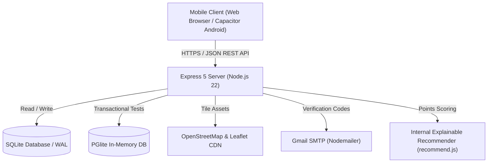

# JoinGun — Deployment Notes, User Guide & Data Permissions

## 1. System Overview & Deployment Status

| Item | Value |
| :--- | :--- |
| **Project** | JoinGun (Activity-partner discovery for university students) |
| **Build Version** | 0.3.0 |
| **Live URL** | [https://joingun.onrender.com](https://joingun.onrender.com) |
| **Hosting Platform** | Render (Web Service, Docker / Native Node environment configured via `render.yaml`) |
| **Local Environment** | Node.js 22.13+, Express 5, SQLite with WAL persistence |
| **Mobile Client** | Responsive Web UI (412 px phone layout) + Capacitor Android wrapper (`android/`) |

> [!NOTE]
> **Free-Tier Cold Start Notice:**
> The live deployment on Render free tier spins down instances after 15 minutes of idle time. The first request after sleep may experience a 15–25 second latency while the instance wakes up (logged as `ISS-06` in testing documentation). Subsequent requests return within normal response times (p95 ~505 ms).

---

## 2. Architecture & Tech Stack



* **Backend:** Express 5 running on Node.js 22, providing RESTful API routes under `/api/` with cookie-based session management (`jg_session`, `HttpOnly`, `SameSite=Lax`).
* **Database:** SQLite with foreign-key enforcement and Write-Ahead Logging (`PRAGMA journal_mode = WAL`) in production/local; PGlite / temporary SQLite used during automated test runs (`server/test/*.test.js`).
* **Frontend:** Plain ES modules and CSS custom properties (tokens in `web/css/tokens.css`), eliminating complex bundling dependencies and ensuring zero build-step overhead.
* **Mapping:** Leaflet 1.9 with OpenStreetMap tile layer (no paid Google Maps API key required).

---

## 3. Data Sources, Permissions & Legal Compliance (rule.md & PDPA)

All personal data handling strictly adheres to the project rules (`rule.md`) and Thai PDPA obligations:

1. **Academic Verification & Data Minimization:**
   * Sign-up is restricted to `.ac.th` email addresses.
   * Plaintext emails are not permanently stored in user profile tables; authentication logs record hashed identifiers, timestamp, IP address, and status.
   * High-risk fields (National ID, home address, religion) are excluded by design from API schemas and database tables.
2. **Granular, Separate Opt-In Consents:**
   * **Location Consent (LR1):** Separate unticked checkbox required before pinning a meeting point.
   * **Participation History Consent (LR1):** Distinct opt-in prompt shown before joining an activity.
   * **AI Recommendation Consent (LR4/LR5):** Dedicated toggle required before user history influences ranking scores.
3. **Data Subject Rights:**
   * **Export ("Download My Data"):** Password-protected JSON export containing user profile, activity posts, and participation history.
   * **Erasure & Retention:** Immediate deactivation on user request; 90-day archive retained for security audit requirements (Computer Crime Act B.E. 2560), followed by automated purge.

---

## 4. Evaluator Quickstart & User Guide

To evaluate JoinGun on the live server or a local machine:

### 4.1 Running Locally
```bash
git clone https://github.com/NetPhurinath/JoinGun.git
cd JoinGun
npm ci
npm run seed      # Seeds 12 realistic campus activities over 7 days
npm start         # Starts local server at http://127.0.0.1:3000
```

### 4.2 Core Journey Walkthrough (5 Steps)
1. **Welcome & Sign-In:**
   * Open `http://127.0.0.1:3000` (or the live URL).
   * Enter a university email ending in `.ac.th` (e.g. `student@mfu.ac.th`). In development/test mode, the verification code is logged to the server console.
2. **Browse Feed & Apply Filters:**
   * View the paged activity stream showing title, date, time, remaining spots badge, and category tags.
   * Filter by category (e.g., Badminton, Futsal, Board Game) or search by keyword.
3. **Inspect Activity & Meeting Location:**
   * Tap any activity card to open its details.
   * Inspect the real-time spots remaining counter and interactive Leaflet map pin showing the exact campus meeting point.
4. **Join Activity with Consent:**
   * Tap "เข้าร่วมกิจกรรม" (Join).
   * Review and accept the participation-history consent prompt.
   * Observe immediate remaining spots decrement (e.g., "เหลือ 3 ที่" $\rightarrow$ "เหลือ 2 ที่").
5. **Set Activity Reminder:**
   * Tap "ตั้งเตือน" to schedule an in-app and phone notification 1 hour prior to activity start.

---

## 5. Deployment Configuration Details

* **Configuration File:** `render.yaml` specifies build and start commands (`npm ci && npm run build`, `npm start`).
* **Environment Variables:**
  * `PORT`: Server listening port (default `3000`).
  * `NODE_ENV`: `production` on Render, `development` locally.
  * `SESSION_SECRET`: Cryptographically random string for session cookie signing.
  * `DATA_DIR`: Filesystem directory for persistent SQLite database and uploads.
  * `SMTP_HOST`, `SMTP_PORT`, `SMTP_USER`, `SMTP_PASS`: Credentials for live email dispatch.
